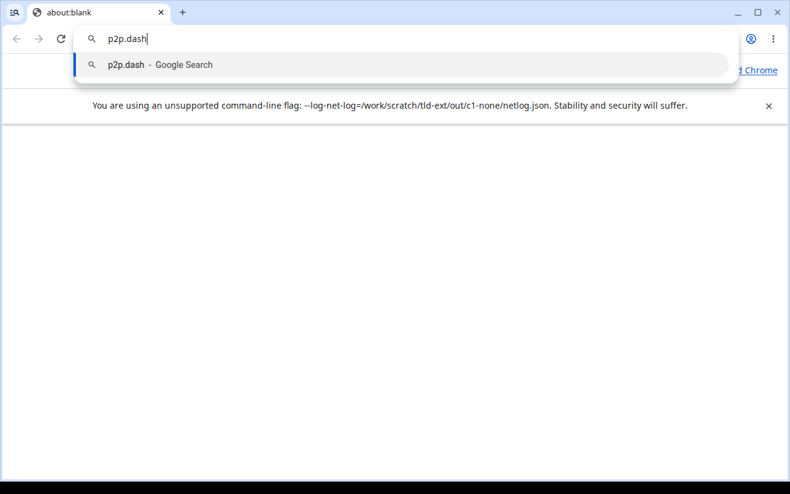
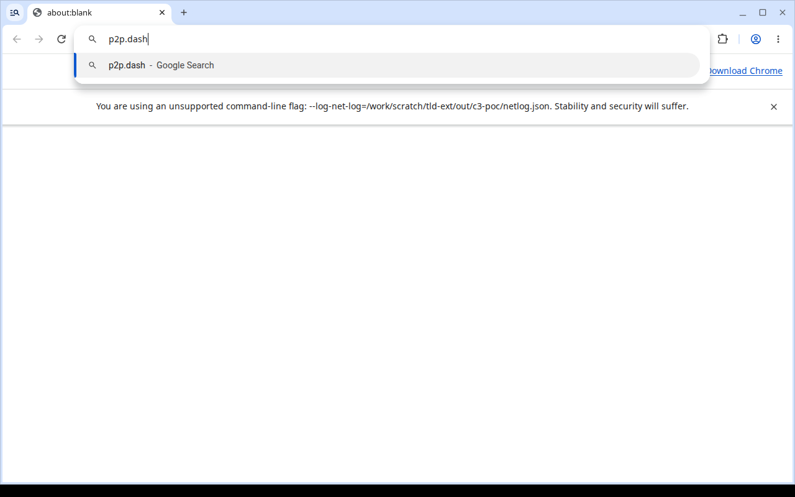
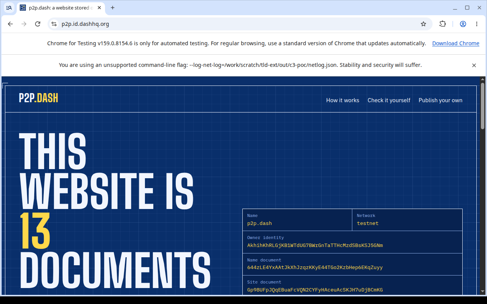
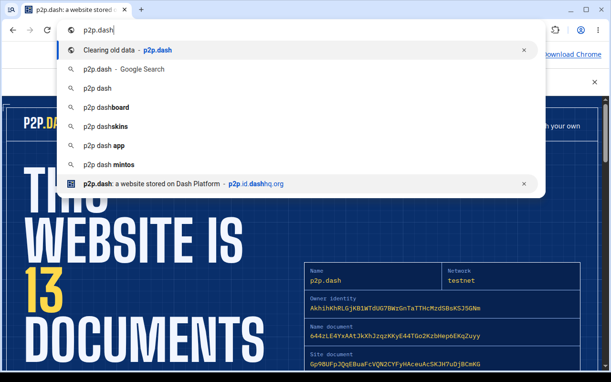
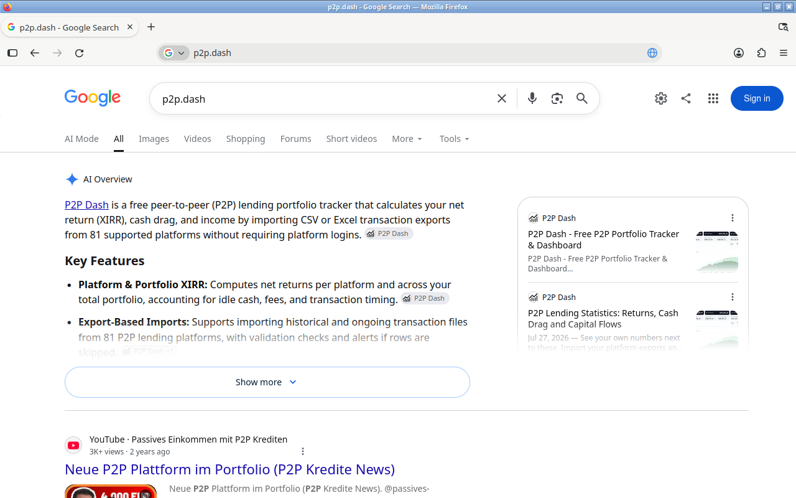
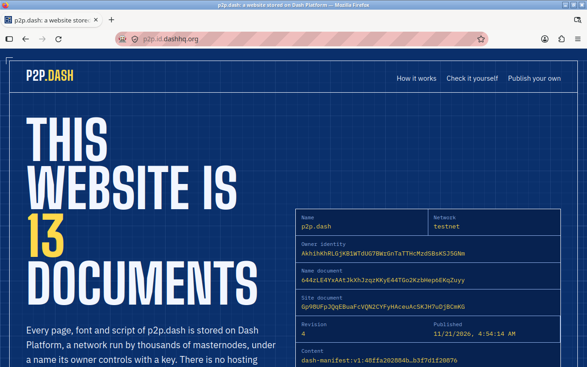
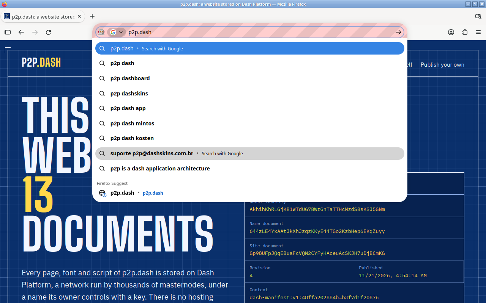
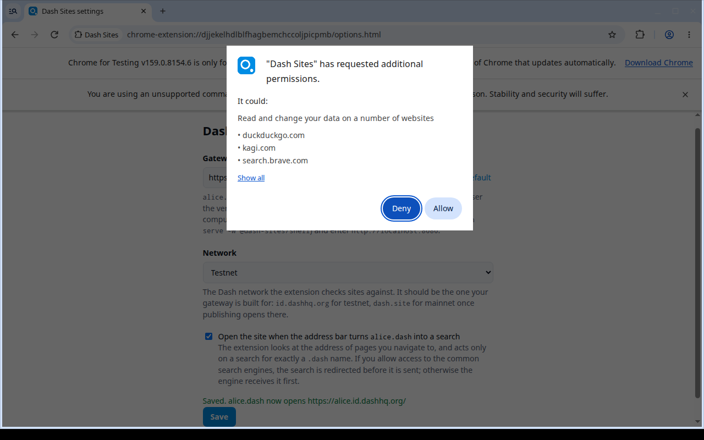

# Typing `alice.dash` in the address bar

Research on how a Chrome or Firefox extension can make a typed `alice.dash` open
the site, with the same trust as the gateway (proofs and file hashes checked in
the browser). Measured on 2026-11-24 with Chrome for Testing 159 and Firefox 161
on Linux, typing into the real address bar (xdotool on an X display). Network
activity was read from Chrome's NetLog and Firefox's `MOZ_LOG=nsHttp`. Firefox
for Android 161 was installed on an emulator, but the emulator kept
disconnecting under host load, so the Android findings come from the Firefox
for Android source, not from a device.

## Recommendation

Keep the current design and add one change:

- A `declarativeNetRequest` (DNR) rule redirects `http(s)://alice.dash/…` to
  `https://alice.<gateway>/…` (`alice.dash.site` on mainnet,
  `alice.id.dashhq.org` on testnet). That host serves only the shell, and the
  shell's service worker proves and verifies the site. This keeps the
  trust-minimized property and gives each name its own secure origin.
- **New (proof of concept on this branch):** DNR redirects a search-engine
  results URL when the query is exactly a bare `.dash` name. The redirect
  happens before the search request is sent. Today a `webNavigation` listener
  calls `tabs.update` after the search has already gone out. These rules need
  optional host access to the search engines, which the user grants in
  settings. Without that access, the current `webNavigation` fallback still
  runs.
- Keep the `dash` omnibox keyword on desktop.
- Publish the same Firefox build on AMO marked as Android-compatible. Firefox
  for Android already treats `alice.dash` as a URL.

What the user gets:

| Browser | `alice.dash` | `alice.dash/`, `http://alice.dash`, `https://alice.dash/x` | `dash alice` | Address bar shows |
| --- | --- | --- | --- | --- |
| Chrome desktop (MV3) | Site opens. The search is redirected before it is sent (PoC, with search access). After one visit, Chrome itself suggests `alice.dash` as a URL | Site opens | Site opens | `alice.dash.site` |
| Firefox desktop | Site opens; the search is redirected before it is sent (PoC, with search access) | Site opens | Site opens | `alice.dash.site` |
| Firefox for Android | Site opens: Fenix treats `alice.dash` as a URL (from source) | Site opens (DNR, same as desktop) | No omnibox API | `alice.dash.site` |
| Chrome for Android, Safari | No extension path that fits. Links to `alice.dash.site` work | | | |

Limits that remain:

- The address bar never shows `alice.dash`. Showing it would need a server
  answering for `.dash`, and the page would not be a secure context (see the
  proxy and webRequest options below).
- While you type, the address bar sends search suggestions with each keystroke
  (`/complete/s?q=p2p.d…`). No extension can stop this. A user who cares can
  turn off search suggestions or use the `dash` keyword.
- The search rules cover 8 engines on their main hosts (`www.google.com`, `www.bing.com`, `duckduckgo.com`, …). A default
  engine on a regional host (such as `google.co.uk`) falls back to
  `webNavigation`, which acts after the search is sent. Host permissions can't
  wildcard a TLD, so covering more means listing each host.

Effort to ship: about 1 day to finish the PoC (grant UI and copy in the
options page, a prompt from the popup, an e2e step for the DNR path, and adding
`dash.site` as the mainnet default once publishing opens there). Then 1–2 days
of store work (CWS listing and justifications, AMO with Android enabled), plus
review wait time. No server or DNS changes.

## What `packages/extension` does today (main at 07b45c8)

- `declarativeNetRequest` rule 1: `^https?://([a-z0-9-]+)\.dash(:port)?(/.*)?$`
  redirects to `https://\1.<gateway>\2`, for `main_frame` and `sub_frame`.
- Omnibox keyword `dash`. `alice`, `alice.dash/blog` and
  `http://alice.dash/x` all open the gateway URL.
- `webNavigation.onBeforeNavigate` sees a search-engine URL whose query is
  exactly a `.dash` name and calls `tabs.update` to the site. It can be turned
  off in settings.
- The popup resolves the name again with its own SDK and compares the result,
  including the file hash, with what the tab was served.
- One source tree builds MV3 packages for Chrome and Firefox. There is no
  `<all_urls>`, `proxy` or `webRequest`.

## Measured behaviour

| Typed | Chrome, no extension | Chrome, main | Chrome, PoC | Firefox, no extension | Firefox, main | Firefox, PoC |
| --- | --- | --- | --- | --- | --- | --- |
| `p2p.dash` | Google search | Google search sent, then redirected. Twice the tab was left stuck loading `about:blank` | Site. No `search?q=p2p.dash` request in the NetLog | Google search | Google search sent (`GET /search?…q=p2p.dash` logged), then redirected | Site. Channel created, no `GET` sent |
| `p2p.dash/` | `http://p2p.dash/`, NXDOMAIN | Site | Site | `http://p2p.dash/`, Server Not Found | Site | Site |
| `http://p2p.dash`, `https://p2p.dash/` | NXDOMAIN | Site | Site | Not found | Site | Site |
| `dash p2p` | Search | Site | Site (in two runs on a brand-new profile it fell through to search shortly after startup; after a 20 s wait it worked) | Search | Keyword row is the default suggestion | Same code as main |
| `p2p.dash` again, after one visit | — | Chrome's first suggestion is the history URL, so it navigates without searching | same | — | Search is still the first suggestion | same |

Chrome did not try an HTTPS upgrade on `p2p.dash/`: the NetLog shows only
`http://p2p.dash/`, consistent with Chrome exempting non-unique hostnames from
HTTPS upgrades. The DNR rule matches both schemes either way. In Firefox, setting the
user pref `browser.fixup.domainsuffixwhitelist.dash = true` in `about:config`
turns bare `p2p.dash` into a URL with no search at all (tested). Extensions
cannot set that pref.

## Options compared

### 1. Omnibox keyword (`dash alice`)

- **What happens:** the user types `dash`, then a space or Tab, then the name.
  The extension opens the gateway URL. Bare `alice.dash` is unaffected.
- **HTTPS and trust:** the same as the redirect; the page is the gateway shell.
- **Store risk:** none; it needs no permission.
- **Firefox for Android:** no `omnibox` API. The PoC guards the call: before,
  `chrome.omnibox.setDefaultSuggestion` ran at the top level of
  `background.ts`, so on Android it would have thrown before the
  `webNavigation` listener after it was registered.
- **Verdict:** keep it as a secondary path. It is reliable, but users have to
  learn it.

### 2. DNR redirect of `*.dash` to the gateway (current)

- **What happens:** `alice.dash/`, `http://alice.dash` and
  `https://alice.dash/x` open `https://alice.<gateway>/x`. The redirect happens
  before DNS, so there is no TLS error and no HSTS question. `.dash` has no
  HSTS preload.
- **Secure context:** yes. The page is HTTPS on a real host, so the service
  worker and `crypto.subtle` work.
- **Trust:** the shell's service worker proves the name and site documents and
  checks every file's SHA-256. The gateway host sends only the shell (checked
  by `e2e/shell.mjs`), and the popup re-checks the result independently. What
  is still trusted: the shell code that host delivers. A user can remove that
  too by pointing the gateway setting at a self-hosted shell.
- **Origin isolation:** one origin per name (`alice.dash.site` and
  `bob.dash.site`), so storage, cookies and the service worker are per name.
  Neither `dash.site` nor `id.dashhq.org` is on the Public Suffix List yet. Until
  they are, all names are one *site* for SameSite cookies and the cookie
  scope, though not one origin. DESIGN §6 already plans a PSL entry.
- **Mixed content:** a `.dash` link on an HTTPS page is a navigation, so it is
  redirected. An `http://alice.dash` iframe on an HTTPS page is subject to
  mixed-content handling before the redirect (not tested). Embedding `.dash`
  resources is out of scope anyway (the rule covers frames and pages only).
- **Store risk:** low. Host access is limited to `*.dash`.
- **Firefox for Android:** DNR has been supported since 113.

### 3. Catching the search for bare `alice.dash`

Without help, both desktop browsers treat bare `alice.dash` as a search because
`.dash` is not a known suffix.

- **`webNavigation` + `tabs.update` (current):** it works, but the search
  request has already been sent by the time the redirect happens; both NetLog
  and MOZ_LOG show it. It is also racy: in two Chrome runs the tab was left
  loading `about:blank`.
- **DNR redirect of the results URL (PoC):** one rule per engine, for example
  `^https://www\.google\.com/search\?(?:.*&)?q=([a-z0-9-]+)\.dash(?:%2F)?(?:[&#].*)?$`
  redirecting to `https://\1.<gateway>/`, case-insensitive (Chrome before 118
  defaulted to case-sensitive). Both browsers apply it before the request
  leaves; this was verified in both. Two Chrome constraints shaped it, and both
  are now in the code and tests:
  - A single combined regex for all engines failed with "exceeded the 2KB
    memory limit when compiled". Each engine is now its own rule, and the
    search rules are installed separately from the `.dash` rule, so a rejected
    search rule can't take the main redirect down with it.
  - `regexSubstitution` replaces only the matched text. A pattern that stopped
    after `q=alice.dash&` produced `alice.<gateway>/oq=…`. Each pattern now
    runs to the end of the URL.
- **Permissions:** `optional_host_permissions` for the 8 engine hosts. DNR
  `redirect` needs host access to the URL it redirects. The options page asks
  when "catch searches" is saved. Without that access, `webNavigation` remains
  as the fallback.
- **Store risk:** moderate and explainable. The rule only acts on a query that
  is exactly `<name>.dash`, and it doesn't change the default search engine or
  its results. Expect a CWS question about Google/Bing host access. Keeping the
  access optional and asking at opt-in time is the conservative choice.
- **Not acceptable:** changing the user's search engine
  (`chrome_settings_overrides.search_provider`) to get the query first. That
  is search hijacking under CWS policy, and AMO treats it the same way.

### 4. Serving the site from an extension page

For example, `chrome-extension://<id>/site.html#alice` or `moz-extension://…`,
with the SDK and verification running inside the extension.

- **Trust:** it would remove the shell host entirely: the strongest trust
  story.
- **What breaks:**
  - All names share one origin, the extension's. Site code there would run
    with extension privileges.
  - To prevent that, sites would have to run in a sandboxed frame, which has an
    opaque origin: no storage, cookies or service worker, and no relative
    fetches seen by the extension worker. Every URL in HTML, CSS and JS would
    have to be rewritten to blob URLs, and anything fetched at runtime or
    built in JS breaks.
  - The address bar shows `chrome-extension://abcdef…/`.
- **Chrome:** extensions cannot answer requests for a web origin with their own
  bytes, so there is no "virtual host".
- **Verdict:** DESIGN §5 already rejected this, and nothing found here changes
  that. It might be worth it only as a fallback viewer for when the gateway is
  unreachable.

### 5. PAC script or `proxy` API so `.dash` "resolves"

- **Chrome:** the `proxy` permission with a PAC script such as
  `if (dnsDomainIs(host, ".dash")) return "HTTPS gw:443"`.
  - It does not change how the address bar classifies input, so bare
    `alice.dash` is still a search.
  - The page is `http://alice.dash`, which is not a secure context: no service
    worker and no `crypto.subtle` in the page.
  - `https://alice.dash` would need a certificate for `alice.dash` that no
    public CA issues.
  - So the proxy has to serve the content, which moves trust to the proxy.
  - It takes over the browser-wide proxy setting, which conflicts with VPN and
    proxy extensions and with corporate PAC.
  - Store review is heavy, and the `proxy` permission shows a warning.
- **Firefox:** `proxy.onRequest` can proxy only `*.dash` without touching other
  traffic. It is available on Android too. It still needs a responder, and it
  still gives an insecure context.
- **Verdict:** no. It costs trust and secure-context features, and its only
  gain is the label in the address bar.

### 6. Firefox blocking `webRequest` and `filterResponseData`

- **What it allows:** Firefox MV3 still has blocking `webRequest`, and
  `filterResponseData` can replace any response body, on Android too. Combined
  with `proxy.onRequest` sending `*.dash` to something that answers (even an
  empty 200), the extension could fetch and verify a site itself and stream the
  verified bytes into `http://alice.dash/…`.
  - The address bar would show `alice.dash`.
  - Origins would be per name, with ordinary storage.
- **Costs:**
  - The page is not a secure context: no service worker or `crypto.subtle`,
    and no `navigator.clipboard`, geolocation or WebAuthn.
  - It needs an always-reachable dummy responder.
  - It is Firefox-only; Chrome MV3 has blocking `webRequest` only for
    policy-installed extensions.
  - It needs `webRequest`, `webRequestBlocking`, `proxy` and `*.dash` host
    access.
  - AMO allows these permissions, but they get human review.
- **Verdict:** a credible Firefox-only "pretty URL" mode later, at about 1–2
  weeks of work. It is not worth giving up secure context for now. For
  blocking-before-send, DNR is enough on Firefox too.

### 7. `registerProtocolHandler` and `web+dash:` handlers

- **Web API:**
  - The gateway page could call
    `navigator.registerProtocolHandler('web+dash', 'https://dash.site/open?u=%s')`.
    Links like `<a href="web+dash:alice">` would then work after the user
    accepts a prompt.
  - It does nothing for typing `alice.dash`.
  - It is not supported in Chrome for Android, but Firefox for Android does
    support it (MDN compat data).
  - Typed `web+dash:alice` in the address bar was not tested.
- **Extension manifest `protocol_handlers`:** Firefox (desktop and Android)
  only, for the `ext+dash:` or `web+dash:` schemes. Chrome does not support it.
- **Verdict:** a reasonable add-on for links shared in chat or documents.
  `https://alice.dash.site` links already do that job without any handler, so
  it is low priority.

### 8. Other ideas considered

- **User-side Firefox pref** `browser.fixup.domainsuffixwhitelist.dash`: it
  works (tested), but users have to set it themselves in `about:config`. It
  belongs in the docs as a tip.
- **Native messaging with a local resolver or proxy:** it needs a native
  install, and it ends up with the same insecure-context problem as option 5.
- **A real `.dash` TLD, or DNS/DoH tricks:** not available. The browser never
  asks DNS before it classifies the input.

## Firefox for Android

- **Address bar:** Fenix's toolbar calls `String.isUrl()`, which is
  `URLStringUtils.isURLLike`. That lenient regex accepts any
  `word.word` without spaces, so `alice.dash` loads `http://alice.dash/`, and
  the DNR rule turns that into `https://alice.dash.site/`. Source:
  `mobile/android/android-components/.../URLStringUtils.kt` and
  `fenix/.../BrowserToolbarSearchMiddleware.kt` in `mozilla-firefox/firefox`.
  There is no search step to catch.
- **APIs (MDN browser-compat-data 8.1.10):**
  - Supported: DNR (113), `webNavigation`, `tabs`, `scripting`, `storage`,
    `proxy.onRequest` and `filterResponseData`.
  - Not supported: `omnibox`.
- **Installing:** release Fenix installs only AMO-signed add-ons that are
  marked as Android-compatible. Unpacked testing needs `web-ext run -t
  firefox-android` against Nightly or a release build with USB debugging. That
  was not done here because the emulator was unstable.

## Store review summary

| Permission | Used by | CWS | AMO |
| --- | --- | --- | --- |
| `declarativeNetRequest` + `*://*.dash/*` | Redirect | Low | Low |
| Optional host access to 8 search engines | PoC search rules | Moderate. Justify as "open `<name>.dash` instead of searching for it"; asked at opt-in | Low–moderate |
| `webNavigation` | Fallback search catch | Shows a "browsing history" warning | Low |
| `activeTab`, `scripting` | Popup re-check | Low | Low |
| `proxy`, `webRequestBlocking`, `<all_urls>` | Not used, and not recommended | High | Moderate, human review |
| `chrome_settings_overrides.search_provider` | Not used | Policy violation | Policy violation |

If search access is granted at install, the `webNavigation` permission could be
dropped, which removes the history warning. That is a product decision.

## The proof of concept on this branch

- `packages/extension/src/shared.ts`: `SEARCH_ENGINES`, `SEARCH_ORIGINS`,
  `SEARCH_RULE_IDS` and `searchRules()`.
- `packages/extension/src/background.ts`:
  - installs the `.dash` rule, then the search rules, separately;
  - reapplies the rules when permissions change;
  - skips the `webNavigation` fallback when a search rule already covers the
    URL;
  - guards the `omnibox` calls.
- `options.ts` and `options.html`: request the optional search-engine access.
- `manifest.json`: adds `optional_host_permissions`.
- `test/shared.test.ts`: tests for the search rules. The replacement in the test
  copies DNR's behavior of replacing only the matched text.

Checks run on this branch:

- `vitest` (13/13), `tsc -b` and `eslint`.
- `e2e/extension.mjs` against live `p2p.dash` (8/8, which exercises the
  fallback path).
- The opt-in flow in Chrome, step by step on the unmodified build:
  1. Settings → Save → Chrome's prompt ("Read and change your data on a number
     of websites") → Allow.
  2. Rules 1–9 were installed.
  3. Typed `p2p.dash` → `https://p2p.id.dashhq.org/`, with no
     `search?q=p2p.dash` anywhere in that session's NetLog.
  4. Unchecking and saving removed rules 2–9 and released the access.
- In Firefox, the opt-in prompt was not exercised. The Firefox runs (and the
  earlier Chrome screenshots) used a copy with the optional access moved into
  `host_permissions`, the same way `e2e/extension.mjs` grants the gateway host.

Open questions:

- **Chrome omnibox search prefetch:** it can fetch a results page outside a
  `main_frame` navigation. It did not appear for `p2p.dash` in these runs, but
  it was not tested deliberately.
- **No way to search for the literal text `alice.dash`:** every results URL
  for that exact query is redirected, including image search and Google's
  "search instead for". The old fallback behaved the same. An escape hatch
  (such as skipping `nfpr=1`) is cheap if it matters.
- **The prompt only appears after Save:** `catchSearches` defaults to on, but
  access is only asked for when the user saves settings. A first-run prompt
  from the popup would close that gap.
